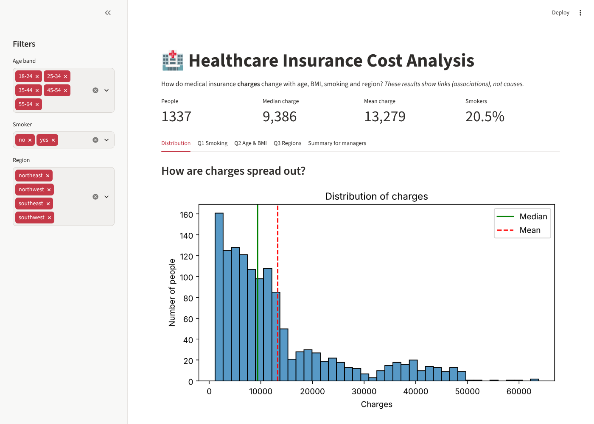

# 🏥 Healthcare Insurance Cost Analysis

**Unit 1 – Data Analytics and Python for Data Preparation · Adam**

| Link | URL |
|---|---|
| GitHub repository | *add after pushing* |
| Live dashboard | *add after deploying* |



---

## 1. Introduction
I play a junior data analyst at a *fictional* health insurance company. Managers want to know **how medical charges change with age, BMI, smoking and region**.

**The problem:** managers look at one average cost, which hides big differences between groups of people.
**Why it helps:** the project shows which groups have higher charges, so managers can plan budgets better.

## 2. Objectives
- Load and clean the data with pandas.
- Answer three questions with charts:
  - **Q1:** Do smokers have higher charges?
  - **Q2:** How are age and BMI linked to charges?
  - **Q3:** How do regions compare?
- Show the results in a simple dashboard for managers.

## 3. Technologies
| Tool | What it does |
|---|---|
| **pandas** | Loads and cleans the data, and groups it (like Excel in Python) |
| **NumPy** | Maths: mean, median, standard deviation |
| **Matplotlib** and **seaborn** | Draw the charts |
| **Jupyter Notebook** | Holds the code, results and explanations in one document |
| **Streamlit** | Turns `app.py` into a web dashboard (the brief requires one) |

## 4. Features
- **ETL:** load the CSV, check it (missing values, duplicates, wrong values), clean it, then save a clean copy.
- **Charts:** histogram, box plot, scatter plots, bar charts and a heatmap.
- **Dashboard:** filters for age band, smoker and region, with numbers and charts that update instantly.
- **Manager summary:** a short, checked summary in plain English.

## 5. Project structure
```
healthcare-insurance-analysis/
├── Healthcare_Insurance_Analysis.ipynb   ← the full analysis (main work)
├── app.py                                ← the dashboard
├── requirements.txt                      ← libraries to install
├── data/raw/insurance.csv                ← original data (never changed)
├── data/clean/insurance_clean.csv        ← cleaned data (made by the notebook)
└── images/                               ← screenshots for this README
```

## 6. How it works
1. **Extract:** `pd.read_csv()` loads the raw file.
2. **Transform:** check missing values (`isna()`), duplicates (`duplicated()`), text and value ranges; remove the 1 duplicate; add `age_band` and `bmi_category`.
3. **Load:** save the clean data with `to_csv()`, reload it and check it.
4. **Analyse:** `groupby()` gives the count, mean and median for each group, and the charts show the patterns.
5. **Dashboard:** `app.py` reads the clean file and filters it with the sidebar choices.

## 7. Installation
You need **Python 3.11 or newer**.
```bash
cd healthcare-insurance-analysis
python -m venv venv
venv\Scripts\activate            # Windows
# source venv/bin/activate       # Mac / Linux
pip install -r requirements.txt
```
No passwords or settings are needed.

**Run the notebook** (run it first, because it creates the clean data):
```bash
jupyter notebook Healthcare_Insurance_Analysis.ipynb
```
Then click **Kernel → Restart & Run All**.

**Run the dashboard:**
```bash
streamlit run app.py
```
It opens at http://localhost:8501. Press `Ctrl + C` to stop it.

**Put it on GitHub:**
1. Create a new public repository on github.com.
2. Run:
```bash
git remote add origin https://github.com/YOUR-USERNAME/healthcare-insurance-analysis.git
git push -u origin main
```

**Deploy the dashboard:**
1. Go to https://share.streamlit.io and sign in with GitHub.
2. Click **Create app**, then choose your repository with branch `main` and file `app.py`.
3. Click **Deploy**.
4. Paste both links into the table at the top of this README.

## 8. How to use it (example)
1. Open the dashboard. It shows **1,337 people**, a median of **9,386** and a mean of **13,279**.
2. Set **Smoker = yes**. The count changes to **274 people**.
3. Open **Q1 Smoking** to see that smokers' charges are much higher.
4. Open **Q2 Age & BMI**. Smokers' charges jump when BMI is above 30.
5. Remove all regions. A friendly warning appears instead of an error.
6. Open **Summary for managers**.

## 9. Implementation decisions
- **No missing values**, so nothing needed filling in.
- **1 duplicate removed.** Every value was identical, and removing it changes the mean by less than 0.1%.
- **High charges kept.** They are real: 136 of the 139 highest are smokers.
- **Median used as the "typical" value**, because a few very large charges pull the mean up.
- **Region checked within smoking groups**, to avoid a misleading conclusion.

## 10. Testing and results
| Test | Result |
|---|---|
| Notebook runs top to bottom with no errors | ✅ |
| Clean data checks (no missing values, no duplicates, valid values) | ✅ |
| Dashboard numbers match the notebook (1,337 / 9,386 / 13,279) | ✅ |
| Filter Smoker = yes gives 274 people; Region = southeast gives 364 | ✅ |
| Empty filter shows a warning, not a crash | ✅ |

**Main findings:**
1. Smokers' median charge is **34,456** vs **7,346** for non-smokers, about **4.7× higher**.
2. Charges **rise with age**: the median is 2,458 at 18–24 and 13,227 at 55–64.
3. BMI matters **mainly for smokers**: the correlation is 0.81 for smokers and 0.08 for non-smokers.
4. The southeast has the highest average, but it also has the most smokers (25%). Among non-smokers it is the lowest.

**Limitations:**
- The data is simulated.
- There are no dates and no medical details.
- There are only 274 smokers.
- The currency is not stated (assumed US dollars).
- The dashboard has not been tested online yet (test it after deploying).

## 11. Future improvements
- Use data with dates and medical details, to explain *why* costs differ.
- Add a simple prediction model.
- Add hover tooltips to the charts.

## 12. Conclusion
I cleaned a raw dataset, answered three questions with charts and built a dashboard. **Smoking, age and (for smokers) BMI** have the strongest links with higher charges. These are links, not causes, so the results should be used for planning, not for judging individual people.

---

## Presentation Guide – How to Explain This Project

### Opening (say this)
> "My project is a Healthcare Insurance Cost Analysis. I acted as a junior data analyst for an insurance company. Managers wanted to know which factors are linked to higher medical charges. I used Python to load and clean a dataset of about 1,300 people, made charts to answer three questions, and built a dashboard so managers can explore the data."

### Purpose (say this)
> "Managers usually look at one average. But a typical non-smoker is charged about 7,000 and a typical smoker about 34,000. My project shows these differences clearly."

### How it works (say this)
> "First I **load** the CSV with pandas. Then I **check and clean** it. There were no missing values, one duplicate row, which I removed, and I kept the very high charges because they are real. Then I **save** a clean copy and use it for all my charts with Matplotlib and seaborn. Finally, the dashboard reads the clean data and lets you filter it."

### Demo order
1. **Notebook:** show the missing-values check and the duplicate.
2. **Notebook:** show the histogram. "The mean is higher than the median because of a few very high charges."
3. **Dashboard:** show the headline numbers.
4. **Q1 tab:** "Smokers pay about 4.7 times more."
5. **Q2 tab:** "Charges rise with age. For smokers, high BMI means much higher charges."
6. **Q3 tab:** "The southeast looks expensive, but that's because it has more smokers."
7. **Filters:** set Smoker = yes, then remove all regions to show the warning.
8. **Summary for managers.**

### Key concepts
- **ETL:** load the data, clean it, then work with the clean version.
- **Mean vs median:** the mean is the average; the median is the middle value. The median is better when a few values are very large.
- **Outlier:** a value far from the others. I kept them because they are real.
- **Correlation:** how strongly two numbers move together, from −1 to +1.
- **Correlation is not causation:** moving together doesn't prove one causes the other.
- **Confounding:** a hidden factor (smoking) makes another factor (region) look important.

### Likely questions and answers
**Why the median?**
> "Charges are skewed. A few huge values pull the mean up, so the median shows a typical person better."

**Why didn't you remove outliers?**
> "They are real costs, mostly from smokers. Removing them would hide the main finding."

**Did you have missing values?**
> "No. I checked with `isna().sum()` and every column had zero."

**Does smoking cause higher charges?**
> "The data shows a strong link, but it can't prove cause. There's no medical information."

**Why is the southeast more expensive?**
> "It has the most smokers. Among non-smokers it is actually the cheapest region."

**How did you use AI?**
> "I used Claude to help with code and to draft the manager summary. I checked everything. The AI draft said smoking *causes* higher costs, and that BMI matters for everyone. Both were wrong, so I corrected them."

**What about privacy?**
> "Health data is sensitive under UK GDPR. This dataset has no names and is simulated, but I still kept only the columns I needed and kept the raw data separate."

### Closing (say this)
> "To sum up, I cleaned the data, answered three questions and built a dashboard. Smoking, age and BMI for smokers are most linked to higher charges. These are links, not causes, so they help with planning, not with judging individuals. Thank you!"

---

**Dataset:** Kaggle – Healthcare Insurance (https://www.kaggle.com/datasets/willianoliveiragibin/healthcare-insurance), accessed 9 Nov 2026. Add the licence shown on the Kaggle page here.
**AI acknowledgement:** Claude (Anthropic) helped with code and drafting. All results were checked in the notebook.
